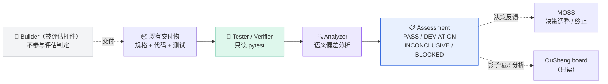
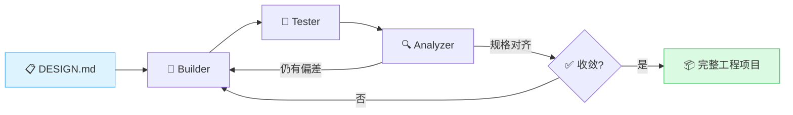

<div align="center">

<br>

# 🪵 MoDou（墨斗）· Assurance Runtime

### 独立验收运行时 — Tester 确定性验证 + Analyzer 偏差分析

<br>

以既有交付物、规格与验收标准为依据，独立识别偏差、验证结果、输出可核验的验收结论。<br>
Builder 只作为**被评估的执行插件**，不参与评估判定。

<br>

[](./CHANGELOG.md)
[](https://github.com/georgewangchn/MoDou/actions/workflows/ci.yml)
[](./LICENSE)
[](#)
[](./CONTRIBUTING.md)

<br>

[🚀 快速开始](#-快速开始) · [🧭 定位](#-定位三-runtime-体系) · [📖 技术报告](./AI%20Software%20runtime%28ASR%29技术报告.md) · [🌐 在线演示](https://georgewangchn.github.io/MoDou/)

<br>

</div>

---

> ### 💡 核心理念
> **被评估方不能自证合格。**
>
> Tester 的 `test_pass_rate` 是确定性地面真值；Analyzer 的语义判断只形成 finding 与建议，不替代事实验证。
> 证据不足时输出 `INCONCLUSIVE`，不默认 `PASS`。

---

## 📑 目录

- [定位（三 Runtime 体系）](#-定位三-runtime-体系)
- [三种工作模式](#-三种工作模式)
- [快速开始](#-快速开始)
- [CLI 参考](#-cli-参考)
- [公共 API（库方式嵌入）](#-公共-api库方式嵌入)
- [配置](#-配置)
- [项目结构](#-项目结构)
- [能力状态](#-能力状态)
- [集成](#-集成)
- [安全](#-安全)
- [术语与命名](#-术语与命名)
- [相关文档](#-相关文档)

---

## 🧭 定位（三 Runtime 体系）

依据《三 Runtime 统一体系最终方案》Final 1.0，MoDou 是其中的 **Assurance Runtime**：

| 系统 | Runtime | 职责 | 与 MoDou 的关系 |
|---|---|---|---|
| MOSS | Decision Runtime | 决策形成、治理、版本化与反馈接收 | 消费 MoDou 的决策反馈（[反馈通道](#-集成)） |
| OuSheng | Organization Runtime | 任务组织、Agent 协作、执行与证据提交 | MoDou 对其 board 做只读影子偏差分析（模式 C） |
| **MoDou（墨斗）** | **Assurance Runtime** | **Tester 验证 + Analyzer 偏差分析 → 独立验收结论** | — |

**价值重心**：MoDou 的价值不来自代码生成，而来自 **Tester 的确定性验证与 Analyzer 的偏差分析**——在既有交付物上独立给出可核验的验收结论。Builder 的自我声明不构成验收证据。LLM 是语义理解与辅助诊断的能力组件，不是第四个 Runtime，也不拥有最终验证裁决权。

三种完成状态不得合并：`Execution Completed`（执行方报告完成）≠ `Deliverable Accepted`（交付过验收）≠ `Decision Outcome Achieved`（业务目标达成）。



---

## 🏗️ 三种工作模式

### 模式 A — 独立评估（核心价值，Implemented）

```bash
asr assess --project my_project --spec acceptance.yaml --no-analyzer
```

```text
MoDou 独立评估 — /path/to/my_project
状态: PASS
验证: pytest 12/12 passed
验收: 1/1 项有证据
语义分析: skipped
```

评估链路**只读**：不生成测试、不回写项目、不调用 Builder。`--json-output` 导出结构化 Assessment；去掉 `--no-analyzer` 启用语义偏差分析（需 `opencode` CLI）；`--enable-verifier compile_check` 可加挂确定性验证器插件（[Verifier SDK](#-能力状态)）。

测试全绿但没有验收基准时输出 `INCONCLUSIVE`——**执行完成不等于目标达成**。

### 模式 B — 软件工程收敛插件（保留能力，Implemented）

```bash
asr run --project my_project --max-iterations 20
```

Builder → Tester → Analyzer 收敛链路，控制论引擎驱动（RepairMode 状态机、增量测试、自适应 patch 限幅、Formal Guards、振荡检测、A/B 回滚、Circuit Breaker——详见[技术报告 v2.0](./AI%20Software%20runtime%28ASR%29技术报告.md)）。此插件**不参与评估判定**。



### 模式 C — 绳上保证（OuSheng board 影子偏差分析，Experimental）

对 OuSheng board 只读快照做两级分析（decided design → item 级 + design 级聚合），默认静默影子；校准达标 + PM 授权后才可经官方 MCP 写回纠偏建议（backlog 分诊 = 授权）。

```bash
asr board-assess --board <board克隆> --no-llm          # 影子评估（plumbing 模式）
asr board-watch --board <board克隆> --once              # 定时巡检单周期
asr board-trend                                       # 趋势汇总（复发/解决指纹）
```

生产启用前置：注入校准达标（`board-calibrate`，3 轮全过）、PM 注册 `modou` actor 并授权。设计基线见《MODOU × OuSheng 偏差分析集成方案》。

---

## 🚀 快速开始

| 依赖 | 版本 | 说明 |
|---|---|---|
| Python | 3.11+ | macOS / Linux |
| Node.js | 18+ | opencode CLI 依赖 |
| opencode CLI | >= 2 | LLM 调用后端（模式 A 的 Analyzer、模式 B、模式 C 语义层需要） |

```bash
# 1. 安装
git clone https://github.com/georgewangchn/MoDou.git && cd MoDou
python -m venv .venv && source .venv/bin/activate
pip install -e .

# 2. 安装 opencode CLI（需要语义分析/收敛插件时）
npm install -g opencode-ai

# 3. 初始化项目（生成 DESIGN.md / opencode.json / asr_config.yaml 模板）
asr init --project my_project

# 4. 配置 LLM：编辑 my_project/opencode.json（任意 OpenAI 兼容接口）
#    baseURL + apiKey + model，示例见 asr init 生成的模板

# 5. 环境检查
asr doctor --project my_project

# 6. 独立评估
asr assess --project my_project --no-analyzer
```

**退出码契约**（全命令一致，流水线可依赖）：`0` = PASS / 成功；`1` = DEVIATION / INCONCLUSIVE / 未收敛；`2` = BLOCKED / 环境错误。

---

## ⌨️ CLI 参考

| 命令 | 模式 | 说明 |
|---|---|---|
| `asr init --project <dir>` | — | 初始化项目（DESIGN.md / opencode.json / asr_config.yaml 模板） |
| `asr doctor --project <dir>` | — | 环境预检（opencode / Python / 配置；含明文密钥告警） |
| `asr assess --project <dir> [--spec <yaml>]` | A | 只读独立评估：四态 + 退出码；`--no-analyzer` 纯确定性；`--enable-verifier <name>` 挂验证器插件；`--decision-ref` / `--feedback-dir` 产出决策反馈 |
| `asr run --project <dir> [--max-iterations N]` | B | 收敛插件（Builder → Tester → Analyzer） |
| `asr board-assess --board <dir> [--design T…] [--item ID…]` | C | 影子两级偏差分析（只读）；`--no-llm` plumbing 模式 |
| `asr board-calibrate --suite <dir> [--rounds 3]` | C | 注入校准（写回的唯一前置，全部轮次通过才算达标） |
| `asr board-writeback --assessment <asm.json> [--execute]` | C | 纠偏写回（默认 dry-run；仅经官方 MCP；fingerprint 幂等 + fp 黑名单） |
| `asr board-watch --board <dir> [--once] [--interval S]` | C | 定时影子巡检（cycle 隔离；last-run.json 非阻塞信号） |
| `asr board-trend [--store-dir <dir>]` | C | 趋势汇总（状态分布 / 偏差直方 / 复发与解决指纹） |
| `asr board-mark --assessment <asm> --verdict tp\|fp --by pm` | C | PM 抽检标记（precision 账本，写回资格数据源） |
| `asr feedback-export --assessment <asm.json> --decision-ref <锚点>` | — | 对存档 Assessment 追溯生成 `modou/feedback@1` 决策反馈信封 |

---

## 🐍 公共 API（库方式嵌入）

`modou/public-api@1`（3.1.0 起，Experimental）——cruise / CI / 决策反馈方可以库方式消费，不必走子进程：

```python
import asyncio, asr

assessment = asyncio.run(asr.assess(
    project_dir, spec_path, use_analyzer=False))
if assessment.status == asr.STATUS_PASS:
    ...
```

仅 `__all__` 内的名字是公共 API（`assess` / `run_verification` / `Assessment` / `Finding` / 四态常量 / `__version__`）。`run` 会改写项目，刻意保持 CLI-only。

---

## ⚙️ 配置

LLM 的实际 provider / 密钥 / 模型配置在**目标项目的 `opencode.json`**（`asr init` 生成模板；支持任意 OpenAI 兼容接口：vLLM / Ollama / OpenAI / DeepSeek 等）。

| 环境变量 | 说明 |
|------|------|
| `ASR_OPENCODE_TIMEOUT` | opencode 单次调用超时秒数（默认 1800；超时终止子进程并报错，防挂起） |
| `ASR_OPENCODE_AUTO` | 设为 `1` 时给 opencode 追加 `--auto`（自动批准未显式拒绝的权限）。默认关闭，权限走 `opencode.json` 白名单 |
| `ASR_VERBOSE` | 设为 `1` 启用详细日志 |
| `FEASIBILITY_LLM_*` | 仅作参考值；`FEASIBILITY_LLM_API_KEY` 已不读取（3.0.0 起不再写入 `asr_config.yaml`，密钥只放 opencode 配置） |

---

## 📁 项目结构

```
MoDou/
├── asr/                          # 核心包（公共 API 面：import asr）
│   ├── assurance/                # 独立评估引擎
│   │   ├── project.py            #   模式 A：Verifier + Analyzer + 验收证据登记
│   │   ├── pipeline.py / grading.py / dossier.py / assessor.py / compose.py
│   │   │                         #   模式 C：快照→分级→案卷→评佃员→门→存档
│   │   ├── board_model.py        #   中立 board 数据模型（防腐层核心侧）
│   │   ├── decision_feedback.py  #   MOSS 决策反馈通道（modou/feedback@1）
│   │   ├── watch.py / store.py / calibration.py / feedback.py
│   │   └── xcheck.py             #   与 converge 的四分类对账
│   ├── adapters/                 # 防腐层
│   │   ├── base.py               #   OrganizationAdapter 协议 + 注册表
│   │   └── ousheng/              #   唯一知道 board 格式的模块（快照 + MCP client）
│   ├── agents/                   # Builder / Tester / Analyzer + opencode 后端
│   ├── controller/convergence.py # 控制论收敛引擎（模式 B）
│   ├── plugins.py + verifiers/   # Verifier Plugin SDK + 内置验证器
│   ├── cli/main.py               # CLI 入口
│   └── git_read.py / config / events / dag / patch / spec / memory
├── tests/                        # 单元测试（全绿，数量以 CI 为准）
├── docs/                         # 设计基线 / 联测清单 / 模拟测试报告
└── pyproject.toml                # 包定义（PyPI 名 asr-runtime）+ 质量门禁配置
```

---

## 📊 能力状态

能力断言按 Implemented / Experimental / Planned 标注，禁止把设计写成现状。Implemented 依据代码与测试标注，不代表已完成生产可用性验证。

| 能力 | 状态 | 说明 |
|---|---|---|
| 模式 A：独立评估（`asr assess`） | **Implemented** | 只读 pytest + 结构化 findings + 验收证据登记 + 四态 |
| 模式 B：收敛插件（`asr run`） | **Implemented** | RepairMode / 限幅 / Formal Guards / 振荡检测 / 回滚，见技术报告 |
| 模式 C：绳上保证（`board-*` 全家） | **Experimental** | 影子两级分析 + 注入校准 **CALIBRATED**（检出 100%×3 轮、误报 0、PM precision 90% n=21）+ MCP 写回闭环（fingerprint 幂等）+ 定时巡检；生产启用需校准达标 + PM 授权 |
| 公共 API v1（`import asr`） | **Experimental** | 3.1.0；`modou/public-api@1`，`run` 保持 CLI-only |
| 组织运行时 Adapter 协议 | **Experimental** | 3.1.0；第二个组织运行时接入 = 注册新 adapter，核心零改动 |
| Verifier Plugin SDK | **Experimental** | 3.1.0；`--enable-verifier` / `modou.verifiers` entry-point；内置 `compile_check`；插件异常永不崩溃评估、永不促成 PASS |
| MOSS 决策反馈通道 | **Experimental** | 3.2.0；`modou/feedback@1` 拉取式信封（不推送、无常驻）；三条流：决策结果 / 规格质量（仅 `BASELINE_DEFICIENT`·`SPEC_INCOMPLETE`·`TARGET_MISS` 进决策通道）/ 置信度 |
| Assurance Core（Contract Registry / Deviation Engine / Feedback Controller 等） | Planned | 方案文档 §6.2；`asr assess` 为最小可用子集 |
| DEP 六对象与事件机制 | Planned | 按设计基线 §10 暂不做；跨系统集成经公共 API + adapter 协议 + 退出码契约实现 |

---

## 🔌 集成

三条集成边，全部**拉取式、低耦合**（合并运行不要求任何一方为另一方改代码）：

| 集成对象 | 通道 | 文档 |
|---|---|---|
| **OuSheng**（组织运行时） | board git 快照（只读）· 官方 MCP 写回（校准达标后）· 退出码契约 | [集成方案](./docs/MODOU_OuSheng_偏差分析集成方案.md) · [联测配合清单](./docs/MODOU_OuSheng_联测配合清单.md) |
| **MOSS**（决策运行时） | `modou/feedback@1` 反馈信封（`--feedback-dir` 落盘，MOSS 拉取；`decision_ref` 锚点贯穿） | [联测清单 D 节](./docs/MODOU_OuSheng_联测配合清单.md#d-moss-集成3200-起决策反馈通道) |
| **CI / 流水线** | 退出码 0/1/2 + `--json-output` + 公共 API | 本文档 [CLI 参考](#-cli-参考) |

---

## 🔒 安全

- **安全默认值**（3.0.0 起）：`asr init` 不再明文写入 API key；opencode 默认不追加 `--auto`（权限走白名单）；子进程超时强制生效——不要在改动中回退这三条。
- `asr assess` 与 board 系列全程只读；写回仅经官方 MCP 且以校准达标为唯一前置。
- 漏洞报告渠道与已知设计边界见 [SECURITY.md](./SECURITY.md)。

---

## 📖 术语与命名

- **MoDou（墨斗）**：本项目正式名称（方案文档写作 `MODOU`，同一实体）。
- **ASR / asr-runtime**：历史技术标识——包目录 `asr/`、CLI 命令 `asr`、`ASR*` 类名、`ASR_*` 环境变量——被 import 路径与历史数据引用，**永久保留不改**；用户可见输出统一用 MoDou 品牌。改名决策记录见 [CHANGELOG](./CHANGELOG.md)。
- **Assurance Runtime**：目标产品定位；不代表当前已实现方案文档的全部 Core 能力（见[能力状态](#-能力状态)）。

---

## 📚 相关文档

| 文档 | 说明 |
|---|---|
| 📄 [CHANGELOG](./CHANGELOG.md) | 版本变更记录（含 3.0.0 安全加固与各版本行为变更） |
| 🤝 [贡献指南](./CONTRIBUTING.md) | 开发环境、三件套门禁、不可破坏的项目纪律 |
| 🔒 [安全策略](./SECURITY.md) | 漏洞报告渠道与已知设计边界 |
| 📐 [集成方案](./docs/MODOU_OuSheng_偏差分析集成方案.md) | 模式 C 设计基线（Final 1.0，硬约束四条） |
| 🧪 [模拟测试报告](./docs/MODOU_模拟测试报告_12场景84轮.md) | 12 场景 × 84 轮端到端验证（真实 CLI 进程边界） |
| 📡 [联测配合清单](./docs/MODOU_OuSheng_联测配合清单.md) | OuSheng / MOSS 联调阻塞项与场景约定 |
| 📖 [技术报告 (v2.0)](./AI%20Software%20runtime%28ASR%29技术报告.md) | 系统架构、控制论优化体系、端到端验证（文件名为历史外链，保留） |
| 🌐 [在线演示](https://georgewangchn.github.io/MoDou/) | 系统效果验证测试报告 |

---

<div align="center">

**MIT License**

</div>
